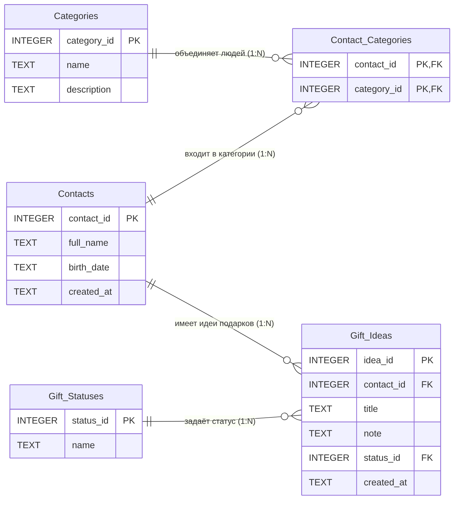

# Трекер дней рождения

Техническое задание и прототип приложения «Трекер дней рождения»: хранит даты рождения друзей и родственников.

## Возможности текущей версии (v1.0.0)

- добавление человека (ФИО и дата рождения) с проверкой ввода;
- список сохранённых людей;
- удаление записи с подтверждением;
- поиск по части ФИО без учёта регистра.

Данные хранятся только до перезагрузки страницы. Автосохранение запланировано в задаче #17.

## Как запустить

1. Скачайте репозиторий (Code → Download ZIP) или клонируйте его.
2. Откройте файл `index.html` в любом современном браузере. Установка и сборка не нужны.

## Структура проекта

| Файл | Назначение |
|------|------------|
| `index.html` | Разметка страницы |
| `style.css` | Оформление |
| `script.js` | Логика приложения |
| `.github/workflows/ci.yml` | Автоматическая проверка (GitHub Actions) |

## Процесс разработки

- Основная ветка `main` всегда рабочая. Каждая функция делается в ветке `feature/...` и попадает в `main` через Pull Request.
- Сообщения коммитов начинаются с типа изменения: `feat:`, `fix:`, `docs:`, `style:`, `ci:`.
- Версии нумеруются по SemVer (MAJOR.MINOR.PATCH).
- Подробности: страница «Процесс разработки» в [Wiki](https://github.com/NekitosPetin/birthday-tracker-srs/wiki).

## Документация

- [Техническое задание](https://github.com/NekitosPetin/birthday-tracker-srs/wiki/Техническое-задание)
- [План проекта](https://github.com/NekitosPetin/birthday-tracker-srs/wiki/План-проекта)
- [Процесс разработки](https://github.com/NekitosPetin/birthday-tracker-srs/wiki/Процесс-разработки)


## База данных

Схема данных рассчитана на SQLite и приведена к третьей нормальной форме.



| Файл | Назначение |
|------|------------|
| `database/schema.sql` | Создание таблиц, ограничений и индексов |
| `database/seed_data.sql` | Тестовые данные (вымышленные люди) |
| `database/normalization.md` | Подробное описание процесса нормализации |
| `docs/database/er_diagram.png`, `.svg` | ER-диаграмма |

Создать базу и заполнить тестовыми данными:

```bash
sqlite3 birthday.db < database/schema.sql
sqlite3 birthday.db < database/seed_data.sql
```

Подробности: [процесс нормализации](database/normalization.md).
