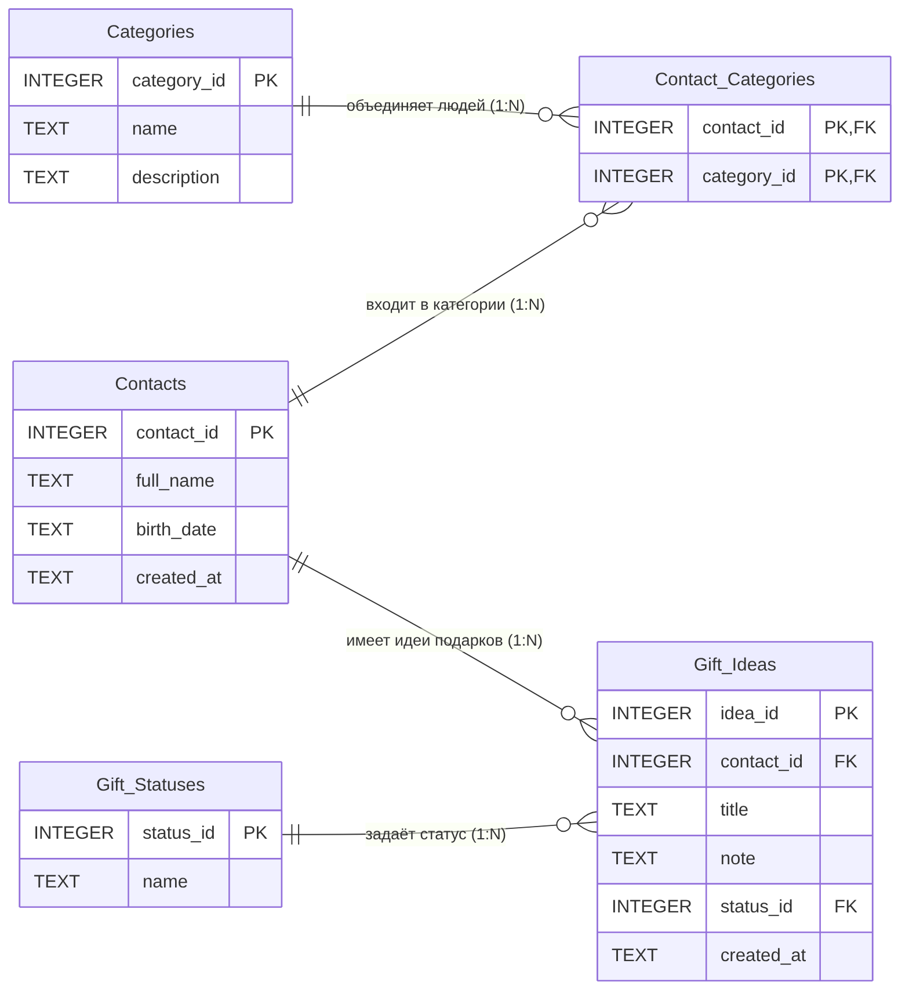

# Процесс проектирования и нормализации базы данных

Приложение «Трекер дней рождения» хранит людей, их категории и идеи подарков. Схема рассчитана на SQLite и приведена к третьей нормальной форме (3NF).

## 1. Исходная (денормализованная) структура

Для демонстрации процесса нормализации возьмём таблицу, в которой всё лежит в одном месте:

`Contacts_Flat (contact_id, full_name, birth_date, categories, gift_title, gift_status)`

| contact_id | full_name | birth_date | categories | gift_title | gift_status |
|------------|-----------|------------|------------|------------|-------------|
| 1 | Иванова Анна Сергеевна | 1990-03-14 | Семья | Набор для рисования | запланирован |
| 1 | Иванова Анна Сергеевна | 1990-03-14 | Семья | Сертификат в книжный магазин | куплен |
| 3 | Петров Дмитрий Алексеевич | 1998-07-21 | Друзья, Коллеги | Беспроводные наушники | подарен |

**Проблемы исходной структуры:**
- **Избыточность:** ФИО и дата рождения повторяются для каждой идеи подарка.
- **Аномалия обновления:** чтобы исправить ФИО человека, нужно изменить все его строки. Чтобы переименовать статус, нужно изменить все строки с этим статусом.
- **Аномалия удаления:** при удалении единственной идеи подарка мы потеряем самого человека и его день рождения.
- **Аномалия вставки:** нельзя добавить человека без идеи подарка, хотя по ТЗ (п. 2.1) человека можно добавить с одним лишь ФИО и датой. Нельзя завести категорию, пока в ней нет людей.

## 2. Нормализация до 1NF (Первая нормальная форма)

**Цель:** убедиться, что все атрибуты атомарны, и в таблице нет повторяющихся групп.

- **Что было не так:** в поле `categories` лежат сразу несколько значений: `Друзья, Коллеги`. Это нарушает 1NF.
- **Наши действия:** сделали так, что одна строка содержит одно значение категории и одну идею подарка.
- **Результат:** `Contacts_1NF (contact_id, category_name, gift_title, full_name, birth_date, gift_status)` с составным ключом `(contact_id, category_name, gift_title)`. Человек с двумя категориями и тремя идеями занимает 6 строк, поэтому избыточность выросла. Это исправляют следующие формы.

## 3. Нормализация до 2NF (Вторая нормальная форма)

**Цель:** устранить частичные зависимости неключевых атрибутов от части составного ключа.

- **Что было не так:** `full_name` и `birth_date` зависят только от `contact_id`, то есть от части ключа. `gift_status` зависит от пары `(contact_id, gift_title)`, но не от `category_name`. Это частичные зависимости.
- **Наши действия:** разделили таблицу по тому, от чего зависят данные:
  - `Contacts (contact_id, full_name, birth_date)` — данные человека;
  - `Contact_Categories (contact_id, category_name)` — принадлежность к категориям;
  - `Gift_Ideas (idea_id, contact_id, title, status_name)` — идеи подарков.
- **Результат:** в каждой таблице неключевые атрибуты зависят от всего первичного ключа. Данные человека хранятся один раз.

## 4. Нормализация до 3NF (Третья нормальная форма)

**Цель:** устранить транзитивные зависимости, когда неключевой атрибут зависит от другого неключевого атрибута.

- **Что было не так:**
  - Если хранить в `Gift_Ideas` не только название статуса, но и его описание, получится цепочка `idea_id → status_name → описание`: описание зависит от названия статуса, а не от идеи. Название статуса при этом повторяется в каждой идее, и переименование требует правки многих строк. Так же устроены категории: их описание зависит от `category_name`.
  - Возраст человека зависит от `birth_date` и от текущей даты. Это производное значение: если его хранить, оно устареет в день рождения.
- **Наши действия:**
  - вынесли справочник `Gift_Statuses (status_id, name)`, в `Gift_Ideas` оставили `status_id` как внешний ключ;
  - вынесли справочник `Categories (category_id, name, description)`, в `Contact_Categories` оставили `category_id`;
  - не стали хранить возраст: он вычисляется запросом (ТЗ п. 2.4).
- **Результат:** все неключевые атрибуты зависят только от первичного ключа своей таблицы.

## 5. Реализация связей «Многие-ко-многим» (M:N)

- **Суть:** человек может входить в несколько категорий (друг и коллега одновременно), а в одной категории много людей. В реляционной БД такую связь напрямую не записать.
- **Наше решение:** создана промежуточная таблица `Contact_Categories (contact_id, category_id)` с составным первичным ключом. Она содержит только пары идентификаторов, а повторы одной и той же пары запрещены.
- **Связи 1:N:** один человек имеет много идей подарков (`Contacts → Gift_Ideas`). Один статус описывает много идей (`Gift_Statuses → Gift_Ideas`).

## 6. Финальная схема



- `Contacts` (contact_id PK, full_name, birth_date, created_at)
- `Categories` (category_id PK, name, description)
- `Contact_Categories` (contact_id FK, category_id FK) — составной PK
- `Gift_Statuses` (status_id PK, name)
- `Gift_Ideas` (idea_id PK, contact_id FK, title, note, status_id FK, created_at)

## 7. Ограничения целостности и индексы

| Что | Зачем |
|-----|-------|
| `CHECK` длины ФИО от 2 до 100 символов | проверка ввода из задачи #16 |
| `CHECK` корректной даты в формате ГГГГ-ММ-ДД, не раньше 1900 года | проверка ввода из задачи #16, невозможные даты вроде 2001-02-29 отклоняются |
| `Gift_Ideas.contact_id NOT NULL` | идея подарка не существует без человека (задача #18) |
| `ON DELETE CASCADE` для идей и категорий человека | при удалении человека его идеи и связи удаляются вместе с ним (задача #13) |
| `ON DELETE RESTRICT` для статуса | нельзя удалить статус, который кто-то использует |
| индекс `idx_contacts_full_name` | поиск по имени (задача #23) |
| индекс `idx_contacts_birth_month_day` | выбор ближайших дней рождения по месяцу и дню (задача #21) |
| индексы `idx_gift_ideas_contact_id`, `idx_gift_ideas_status_id`, `idx_contact_categories_category_id` | быстрые выборки идей человека, идей по статусу и людей по категории |

Проверка «дата рождения не в будущем» остаётся на уровне приложения, потому что зависит от текущей даты.

## 8. Проверка схемы запросами

Схема и тестовые данные проверены в SQLite: `database/schema.sql`, затем `database/seed_data.sql`.

**Возраст на текущий год (ТЗ п. 2.4), ближайшие дни рождения сверху:**

```sql
SELECT full_name, birth_date,
       CAST(strftime('%Y','now') AS INTEGER) - CAST(strftime('%Y', birth_date) AS INTEGER) AS age_this_year
FROM Contacts
ORDER BY strftime('%m-%d', birth_date);
```

**Идеи, которые ещё не подарены (ТЗ п. 2.2):**

```sql
SELECT c.full_name, g.title, s.name AS status
FROM Gift_Ideas g
JOIN Contacts c ON c.contact_id = g.contact_id
JOIN Gift_Statuses s ON s.status_id = g.status_id
WHERE s.name <> 'подарен'
ORDER BY c.full_name, g.title;
```

Результат на тестовых данных:

| ФИО | Идея подарка | Статус |
|-----|--------------|--------|
| Иванов Сергей Петрович | Рыболовный набор | запланирован |
| Иванова Анна Сергеевна | Набор для рисования | запланирован |
| Иванова Анна Сергеевна | Сертификат в книжный магазин | куплен |
| Кузнецов Алексей Игоревич | Кофе в зёрнах | куплен |
| Смирнова Мария Олеговна | Настольная игра | запланирован |
