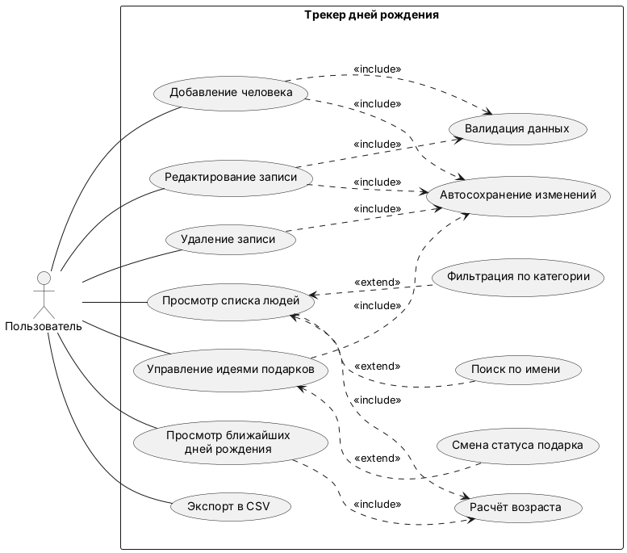
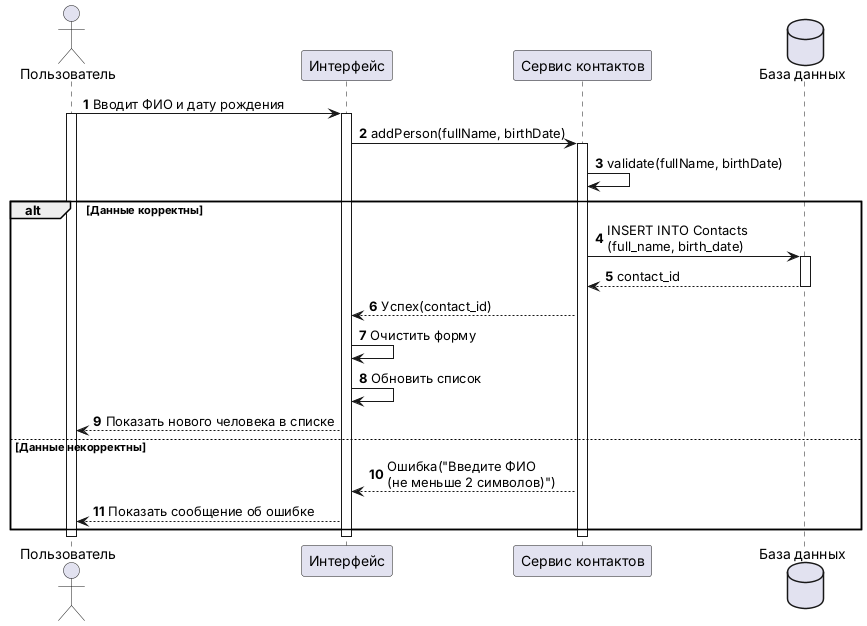
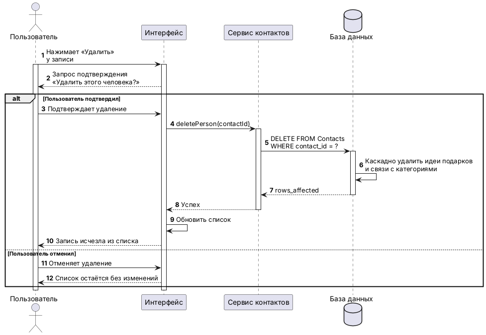
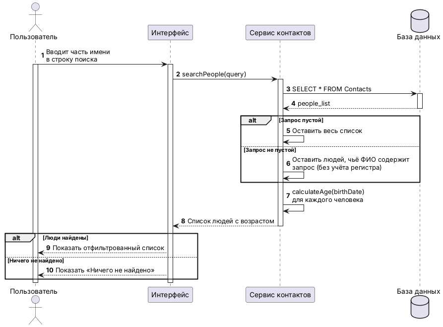
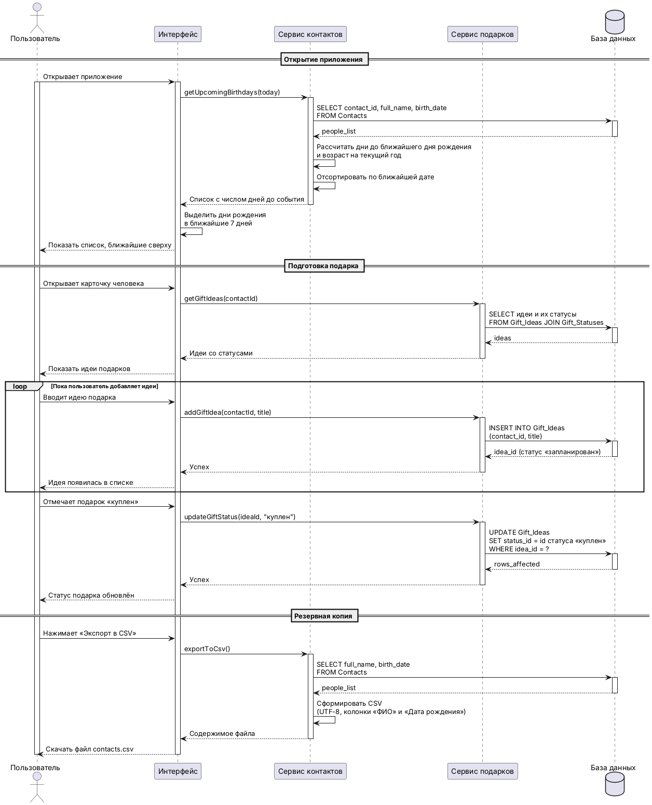

# Диаграммы поведения системы

Приложение «Трекер дней рождения» хранит людей, их даты рождения и идеи подарков. Диаграммы описывают поведение целевой версии с базой данных из лабораторной 4: прототип из лабораторной 3 работает в браузере и пока не обращается к базе.

## Use Case диаграмма



### Акторы

- **Пользователь** — единственный актор. Приложение личное, ролей и учётных записей в ТЗ нет.

### Основные Use Cases

| Use Case | Требование ТЗ |
|----------|---------------|
| Добавление человека | п. 2.1 (#1) |
| Редактирование записи | п. 2.1 (#1) |
| Удаление записи | п. 2.1 (#1) |
| Просмотр списка людей | п. 2.1 (#1) |
| Управление идеями подарков | п. 2.2 (#2) |
| Просмотр ближайших дней рождения | п. 2.3 (#3) |
| Поиск по имени | п. 2.4 (#4) |
| Экспорт в CSV | п. 3 (надёжность) |

### Связи между Use Cases

- **include** (обязательная часть сценария): добавление и редактирование включают «Валидацию данных». Добавление, редактирование, удаление и управление идеями включают «Автосохранение изменений». Просмотр списка и ближайших дней рождения включают «Расчёт возраста».
- **extend** (необязательное расширение): «Поиск по имени» и «Фильтрация по категории» расширяют просмотр списка. «Смена статуса подарка» расширяет управление идеями.

«Фильтрация по категории» опирается на таблицы `Categories` и `Contact_Categories` из лабораторной 4. Отдельного требования в ТЗ для неё нет, поэтому это задел на следующую версию.

## Диаграммы последовательности

Участники: **Пользователь**, **Интерфейс**, **Сервис контактов**, **Сервис подарков** и **База данных** (SQLite, схема из лабораторной 4).

### 1. Добавление человека



Показывает проверку ФИО и даты рождения. При корректных данных запись сохраняется в `Contacts`, форма очищается, список обновляется. При ошибке пользователь видит сообщение, а в базу ничего не попадает.

### 2. Удаление человека



Показывает запрос подтверждения перед удалением. После подтверждения база удаляет запись и каскадно удаляет идеи подарков и связи с категориями (`ON DELETE CASCADE`). При отмене ничего не меняется.

### 3. Поиск по имени



Показывает фильтрацию списка по части ФИО без учёта регистра. Пустой запрос возвращает весь список, при отсутствии совпадений пользователь видит «Ничего не найдено». Для каждого найденного человека рассчитывается возраст на текущий год.

### 4. Ежедневный сценарий



Комплексный сценарий в четырёх частях: открытие приложения и ближайшие дни рождения, подготовка подарка (идеи и смена статуса «запланирован» → «куплен»), экспорт контактов в CSV.

## Используемые инструменты

- **PlantUML** — все диаграммы хранятся как код в файлах `.puml`, их легко версионировать в Git.

Перегенерировать картинки из корня репозитория (нужны Java и PlantUML):

```bash
java -jar plantuml.jar -tpng -tsvg docs/use_case/*.puml docs/behavior/sequence/*.puml
```
